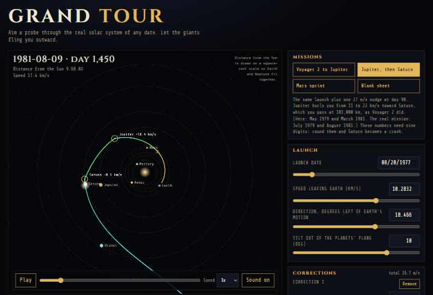

# Grand Tour

> Aim a probe through the real solar system of any date, and let the giant planets fling you outward.

Grand Tour is a spacecraft mission planner you can play. Pick a launch date between 1960 and 2090, and the planets appear exactly where they really were. Then choose your speed, direction and tilt, add up to three small correction burns, and watch a live prediction bend as your probe passes planets. Each close flyby steals or lends energy through **gravity assist**, the trick that carried Voyager 2 past Jupiter, Saturn, Uranus and Neptune on a single flight.



---

## Contents

- [Highlights](#highlights)
- [Quick start](#quick-start)
- [How to play](#how-to-play)
- [Does it match reality?](#does-it-match-reality)
- [How it works](#how-it-works)
- [Project structure](#project-structure)
- [Testing](#testing)
- [Security & privacy](#security--privacy)
- [Accessibility](#accessibility)
- [Known limitations](#known-limitations)
- [Roadmap](#roadmap)
- [Skills & methodology](#skills--methodology)
- [Credits & license](#credits--license)

---

## Highlights

| Feature | What you get |
|---|---|
| **Real planets** | Positions for all eight planets from the [astronomy-engine](https://github.com/cosinekitty/astronomy) library, for any date from 1960 to 2090. |
| **Real gravity assists** | The Sun and all eight planets pull on your probe. Fly close to Jupiter and watch your speed jump (**11.4 to 21.8 km/s** in the Saturn preset). |
| **Live prediction** | Every slider re-flies up to 45 years in about 60 ms, so the path updates as you drag. |
| **Correction burns** | Up to three small burns (along the path and sideways, up to 500 m/s each), the tool Voyager used to fine-tune its aim. |
| **Auto-aim** | Pick a planet and a launch date; a search finds a launch speed, direction and tilt that passes it. |
| **Playback with sound** | Scrub or play the mission; each flyby rings a note (a low one for Jupiter, higher for the small planets). |
| **Four missions** | Voyager 2 to Jupiter, Jupiter then Saturn, a Mars sprint, and a blank sheet. |
| **The open challenge** | Pass Jupiter, Saturn, Uranus *and* Neptune on one flight. See [Does it match reality?](#does-it-match-reality). |

## Quick start

**Requirements:** Node.js 18 or newer and a modern browser (tested in Chromium).

```bash
git clone https://github.com/sirajahmedshaikh454-dev/grand-tour.git
cd grand-tour
npm start
```

Open **http://localhost:5300**. The page uses a vendored copy of the planet library, so `npm start` needs no install. To run the tests or the solver tools, install the one dependency first:

```bash
npm install
npm test
```

## How to play

1. **Pick a mission** on the right, or press *Blank sheet* and choose your own launch date.
2. Drag **speed**, **direction** (degrees left of Earth's own motion) and **tilt** (out of the planets' flat plane). The gold-to-cyan path is your predicted flight, coloured by speed.
3. A ring marks each **flyby** with its speed change. The **Flight log** lists the distance from the planet and the speed in and out.
4. Add a **correction burn** to nudge the aim after launch. The Δv total is shown.
5. Not sure where to start? Choose a planet under **Auto-aim** and press *Aim for me*. Some launch dates have no good aim; the page says so honestly (planets only line up at certain times, and a launch window opens only every year or two).
6. Press **Play** (or `Space`) to fly the mission with sound; drag the time bar to scrub.

| Input | Action |
|---|---|
| `Space` | Play / pause |
| `←` / `→` | Scrub 30 days |
| Number boxes | Type exact values (the box is rewritten with the value actually used) |

> **A lesson built into the game:** the Jupiter-then-Saturn preset is a razor's edge. Its numbers need **nine significant digits**: round them to five and your 101,000 km Saturn flyby becomes a crash into Saturn. Gravity assists amplify tiny errors enormously, which is exactly why real missions fly small corrections.

## Does it match reality?

I checked the simulator against Voyager 2's real mission, using dates and distances from NASA ([Voyager 2 trajectory](https://svs.gsfc.nasa.gov/4140), [mission page](https://science.nasa.gov/mission/voyager2)).

| Check | This simulator | Real Voyager 2 |
|---|---|---|
| Launch on 20 Aug 1977 with **no corrections** reaches Jupiter on | **9 July 1979** (within 3.6 million km) | 9 July 1979 |
| Launch excess speed this needs | 9.9 km/s | roughly 10 km/s (from public mission data; not independently checked here) |
| Jupiter then Saturn, with **one 27 m/s nudge** | Jupiter 490,033 km (May 1979), Saturn **101,329 km** (March 1981) | Jupiter July 1979, Saturn about 101,000 km (August 1981) |
| Speed gained at Jupiter | 11.4 to 21.8 km/s | a large boost toward Saturn |
| **Uranus and Neptune** | **not reproduced** | reached in 1986 and 1989 |

What this shows, and does not:

- The first row is the strongest evidence: a physics model that is wrong would not land on the correct *day* two years after launch.
- The dates in the Jupiter-then-Saturn mission are two to five months early. The real mission flew several small corrections the simulator's single nudge does not copy.
- **I could not make the optimiser find a route to Uranus and Neptune**, so that final leg is left as the game's open challenge rather than faked. It may well be possible with more corrections or a better optimiser.
- A bug in an early version flew only flat to the planets' plane and could never get closer to Jupiter than 0.034 AU. Jupiter's orbit is tilted 1.3 degrees, which puts it about 0.09 AU above the plane. Real launches leave Earth with an out-of-plane component, so the game has a *tilt* control.

## How it works

```
astronomy-engine ──► ephem.js  (daily positions, cubic interpolation, cached)
                        │
 launch settings ──► sim.js   (Sun + 8 planets, velocity-Verlet, flyby detection, burns)
                        │
                        ├──► solve.js (Nelder-Mead + auto-aim) ──► presets.js (found with tools/)
                        ▼
                     app.js ──► canvas map, controls, flight log, playback and sound
```

**Ephemeris.** `ephem.js` asks the library for each planet's heliocentric position once per day (ecliptic J2000, in AU), caches it, and interpolates in between with a cubic curve. Measured against the library: Mercury is off by 181 km at worst, Venus 32 km, every other planet under 2 km.

**Flight physics.** Units are AU and days. The probe feels the Sun and all eight planets as point masses, in the heliocentric frame with the **Sun's own reflex** (the planets pull the Sun too) included. The integrator is velocity-Verlet with an adaptive step: small near planets and in tight orbits, up to a day in deep space, capped at 400,000 steps. A probe closing a circular orbit comes back within 1.9e-5 AU (about 3,000 km) per year at 1 AU.

**Launch.** A patched-conic start: the probe leaves Earth's position with Earth's velocity plus a chosen excess speed v∞, turned `angle` degrees left in the plane and tilted `pitch` degrees out of it. Earth's own gravity is ignored for the first 20 days.

**Flybys and endings.** An encounter starts when you are within three times a planet's reach and records the closest approach and the heliocentric speed in and out. A flight ends by **time** (45 years), **escape** (80 AU), **impact** (a planet or the Sun), or **steps** (the safety cap, reported honestly rather than pretending it ran to the end).

**Auto-aim.** A coarse grid over (speed, direction, tilt) picks a start, then a Nelder-Mead simplex search refines it, aiming for a chosen passing distance. It runs asynchronously so the page stays responsive, and the controls lock while it works.

**Presets** were found by the optimiser (`tools/find-voyager.mjs`, `tools/find-mars.mjs`) against this simulator, then pinned by tests.

## Project structure

```
grand-tour/
├── index.html / style.css   # the page (a "Golden Record" look: gold on black, Cinzel + Share Tech Mono)
├── app.js                   # controls, drawing, flight log, playback, sound, auto-aim wiring
├── ephem.js                 # planet table (masses, radii) and the cached ephemeris
├── sim.js                   # flight integrator, flybys, burns, shared "visit" rule
├── solve.js                 # Nelder-Mead optimiser and auto-aim
├── presets.js               # the four missions
├── server.js                # zero-dependency static server (allow-list, localhost only)
├── vendor/                  # astronomy-engine browser build (MIT licence header kept)
├── tools/                   # find-voyager.mjs, find-mars.mjs: how the presets were found
├── *.test.js                # 20 tests
└── docs/                    # screenshot
```

## Testing

```bash
npm install && npm test
```

**20 tests** cover:

- **Ephemeris:** Earth's longitude on 1 January 2000 (100.4 degrees), Neptune's distance, and interpolation error for six planets.
- **Physics:** a clean Kepler circle (one year, back to the start, energy conserved), exact launch speed, burns that are exactly as big as asked and exactly at right angles, the 20-day Earth exclusion, no fake "Earth flyby" at launch.
- **Reality checks:** the Voyager 2 results in the table above are pinned, so a physics regression fails the build.
- **Robustness:** bad numbers raise a clear `RangeError`, the step cap reports `steps` with the true stop time, and path times always increase.
- **Optimiser:** finds the minimum of a test bowl and finds Mars.
- **Server:** 16 blocked paths (`..`, encoded and double-encoded slashes, `//app.js`, the source files, `.git`, the tests, `node_modules`), a malformed escape, a wrong Host header, and write methods.

**Also checked in a real browser:** all four presets, auto-aim (including the controls locking), the typed-number and date fixes, the phone layout (no sideways scroll), the easter egg and the live hardened server with zero console errors.

## Security & privacy

- **Local only.** The server listens on `127.0.0.1`, answers only `GET`/`HEAD`, and only for the Host names `localhost` and `127.0.0.1` (which stops DNS-rebinding attacks).
- **Allow-list.** It serves nine exact paths. Everything else, including its own source, the tests, `node_modules` and `.git`, returns 404.
- **Headers.** A Content-Security-Policy (also in the page as a meta tag: scripts only from the page's own origin, no framing, no forms, no plugins, `base-uri` and `object-src` off), `X-Frame-Options: DENY`, `nosniff`, `no-referrer`.
- **No injection surface.** All text reaches the page through `textContent`; there is no `innerHTML`, `eval` or storage, and every input is a clamped number or date.
- **Supply chain.** One dependency, [astronomy-engine](https://www.npmjs.com/package/astronomy-engine). The vendored browser build is byte-for-byte the npm package's file (checked by hash) and keeps its MIT licence header. `npm audit`: 0 vulnerabilities.
- **One third-party request:** the page loads two fonts from Google Fonts, which tells Google your IP address. Nothing else leaves your machine, and the app stores nothing.

An independent security review found no exploitable issue; its low-severity suggestions were applied.

## Accessibility

- Every control is a labelled native input or button, with visible focus rings.
- The map canvas has a text description that is rewritten with the outcome, and the **flight log is a plain list**, so nothing depends on the picture.
- Sound is optional and off-able; playback is user-started, never automatic.
- Touch controls are full-size and the layout stacks cleanly at phone width.

## Known limitations

- **Not navigation-grade.** Planets are point masses (no moons, no J2 flattening, no radiation pressure), Earth's departure is a patched-conic simplification, and orbits drift a few thousand km per year at 1 AU.
- **Uranus and Neptune** are not reproduced (see above).
- The map uses a **square-root distance scale** so Earth and Neptune fit together; it is a map, not a to-scale picture.
- The Mars sprint is a fast, expensive route (111 days), not the efficient seven-month transfer.
- Auto-aim takes 5 to 12 seconds and finds *a* solution, not the cheapest; it sometimes finds none for a given date.
- A direct "closest approach to Earth" value is not meaningful in the first weeks after launch.
- **Playback animation and sound were verified by reading the code and driving the same steps by script**; the built-in browser pane could not run animation frames in the background during testing. The drawing cost per frame is unmeasured on slow machines.
- Tested in a Chromium-based browser only.

## Roadmap

- [ ] Find a Voyager-style route to Uranus and Neptune (more corrections, or a better optimiser).
- [ ] A **launch-window** chart (a "porkchop plot") showing which dates reach a planet cheaply.
- [ ] Self-hosted fonts, so the page makes no third-party request at all.
- [ ] Draw the path once per change instead of every frame, for slow machines.
- [ ] Score and share a mission as a link.

## Skills & methodology

**How it was built**

1. **Pitch three, build one.** Three concepts were weighed; the boldest that could be *checked against reality* won: a planner whose Voyager 2 launch can be compared with NASA's dates.
2. **Research first.** A web search of NASA and Wikipedia sources produced the real encounter dates and distances to test against, and shaped the choice of a real ephemeris library over hand-typed orbital elements.
3. **Floor, then ceiling.** The physics core (ephemeris, integrator, flybys) and its tests came first, then the optimiser, then the page, then sound, playback and the extras.
4. **Treat the optimiser as a scientific instrument.** It was used to *test* the physics. When the first search failed, the cause was found rather than hidden: a flat-only launch could never reach Jupiter (hence the tilt control), and aiming at a planet's centre rewards crashing (hence aiming at Voyager's real flyby distances).
5. **Validate against reality, honestly.** The Jupiter date match is pinned by a test. The failures (Uranus, Neptune) are documented, not papered over.
6. **One commit per change**, pushed straight away: 10 commits, each building or fixing one thing.
7. **Three independent reviews in parallel**, then fix everything:
   - A **security review** (a read-only subagent) probed the server with real requests and found no exploitable issue; its hardening items were applied.
   - A **code review** (a second subagent, with physics knowledge) found real bugs: the step cap misreported the end date, the final path point made the end speed read 0, the date slider was off by one day, auto-aim could race with edits, and several tests would still pass if the code were wrong.
   - A **senior-engineer audit** (the *ponytail-audit* plugin, run by a third subagent) found the "visit" rule defined twice, an untested server allow-list, and a stuck status message on errors.
8. **Self-review caught one more:** while reading the code back, a sideways burn was found to use a half-updated velocity. It was fixed with a test before the reviewers saw it.
9. **Browser verification** with viewport emulation and script-driven checks, including against the live hardened server.

**Skills, plugins and tools used**

| Tool | Used for |
|---|---|
| Web search | Voyager 2 real dates and distances (NASA, Wikipedia) |
| **astronomy-engine** (npm, MIT) | Real planet positions |
| **ponytail-audit** plugin (via a subagent) | Senior-engineer audit of the whole repo |
| Security and code-review subagents | Independent, read-only, parallel reviews |
| Plugin catalog search | Looked for token-saving and review plugins; the useful ones were already installed, so nothing was installed |
| Built-in browser (viewport emulation, page scripting) | UI, layout and server-header checks |
| Node `node:test` | The 20 tests |

The visual direction (the "Golden Record" look) was designed directly rather than taken from the design plugin: its generic recommendation did not fit a mission-control instrument.

**Bugs found and fixed during the build:** a flat-launch limit (no way to reach Jupiter), a launch counted as an "Earth flyby", a loose integrator step, a half-updated burn velocity, a step-cap that lied about the end date, a zero end speed, an off-by-one date slider, stale typed values, auto-aim races, a rounding that turned a flyby into a crash (kept as a feature), and test mistakes of my own (wrong expected counts and tolerances).

## Credits & license

- Planet positions: [astronomy-engine](https://github.com/cosinekitty/astronomy) by Don Cross, MIT licence (header kept in `vendor/`).
- Voyager 2 mission dates and distances: NASA ([trajectory](https://svs.gsfc.nasa.gov/4140), [mission](https://science.nasa.gov/mission/voyager2)).
- Code: MIT.

---

<details>
<summary>Spoiler: the easter egg</summary>

Click anywhere on the page (not in a box) and type **dot**. A faint ray of sunlight falls across the map, passing through Earth, and a single pale-blue pixel marks home. The caption reads: *"From out here, everything you have ever known fits in a single pixel of light."* Type it again to turn it off.

</details>
